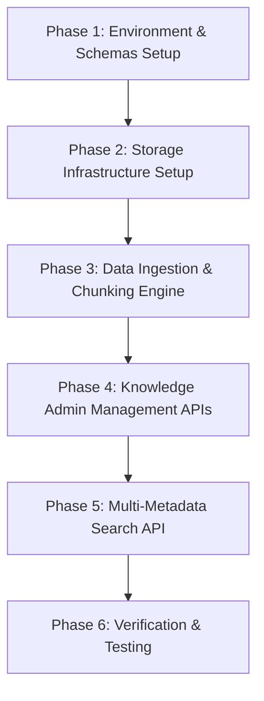

# 📋 KẾ HOẠCH TRIỂN KHAI STORY 1 (STORY PLANNING)
## Xây Dựng Và Quản Lý Kho Kiến Thức Rentzy (Knowledge Storage & Multi-Metadata Search Engine)

---

## 1. THÔNG TIN STORY 1

### 1.1. Mục Tiêu Story 1
Xây dựng một **Kho kiến thức (Knowledge Base) chính thức** cho chatbot AI-Powered AskMe của Rentzy:
- Chỉ truy xuất và sử dụng các nội dung đã được Rentzy phê duyệt chính thức.
- Mỗi thông tin trích dẫn phải bao gồm **URL nguồn chính thức**, **Ngày cập nhật**, **Phiên bản** và **Người phê duyệt**.
- Tự động loại bỏ các nội dung **hết hiệu lực (inactive)** khỏi kết quả truy xuất.
- Cho phép đội ngũ Business quản lý, nạp bài mới, bật/tắt trạng thái hiệu lực mà **không cần sửa prompt hay source code**.

### 1.2. Phạm Vi Nguồn Dữ Liệu
Nguồn nội dung chính cho Story 1 bao gồm:
- **Website/CMS Rentzy & File Training Data:** Giới thiệu Rentzy, Phạm vi dịch vụ, Gói thành viên, Quy trình, Chính sách cọc/đổi trả, Thử đồ tại showroom.
- **Metadata đi kèm:** `status` (`active`/`inactive`), `topic`, `source_url`, `updated_at`, `approver`, `version`.

---

## 2. BẢNG THỐNG KÊ TECH STACK (CÔNG NGHỆ SỬ DỤNG)

| Thành phần Kỹ thuật | Công nghệ Lựa chọn | Phiên bản / Chi tiết | Vai trò trong Hệ thống |
| :--- | :--- | :--- | :--- |
| **Ngôn ngữ Lập trình** | **Python** | `v3.12.2` | Ngôn ngữ chính triển khai hệ thống RAG & Data Pipeline. |
| **Web Framework** | **FastAPI** | `v0.110+` | Xây dựng RESTful API & tự động tạo tài liệu OpenAPI Swagger UI. |
| **Relational Database** | **PostgreSQL** | `v16 (Docker)` | Lưu trữ tài liệu gốc, danh sách Chunks, lịch sử phiên bản & metadata. |
| **Vector Database** | **Qdrant Cloud** | `Cloud Managed` | Lưu trữ Vector Embeddings & **Payload Indexing** phục vụ lọc đa thuộc tính. |
| **Embedding Model** | **Google Gemini Embedding** | `gemini-embedding-2` | Sinh vector ngữ nghĩa 3072 chiều (3072 dims), tối ưu tiếng Việt. |
| **Xử Lý Dữ Liệu** | **Pandas & OpenPyXL** | `Latest` | Trích xuất & làm sạch dữ liệu từ file Excel kịch bản của Rentzy. |
| **Containerization** | **Docker & Docker Compose** | `v3.8 Spec` | Đóng gói và chạy ngầm PostgreSQL 16 local. |
| **Automated Testing** | **Pytest & HTTPX** | `v9.1+` | Kiểm thử tự động tính đúng đắn của các API & bộ lọc Qdrant. |

---

## 3. LỘ TRÌNH PHÂN CHIA CÁC PHASE (PHASE BREAKDOWN)

---

### 📍 Phase 1 — Environment & Metadata Schema Setup (Khởi Tạo Cấu Trúc)
- **Mục tiêu:** Cấu trúc dự án Python 3.12, FastAPI, Pydantic v2 và SQLAlchemy 2.0.
- **Input:** Yêu cầu Metadata từ Rentzy.
- **Output:** Pydantic Schemas & SQLAlchemy Models cho Document & Chunk Metadata.
- **Điều kiện hoàn thành:** Server FastAPI khởi chạy thành công, endpoint `/health` trả về `200 OK`.

---

### 📍 Phase 2 — Storage Infrastructure Setup (Hạ Tầng PostgreSQL & Qdrant)
- **Mục tiêu:** Thiết lập kết nối PostgreSQL và khởi tạo Qdrant Collection với Payload Indexing.
- **Input:** Connection strings PostgreSQL & Qdrant Cloud API Key.
- **Output:** Bảng `documents`, `document_chunks` trên Postgres và Collection `rentzy_knowledge` (3072 dims) trên Qdrant Cloud.
- **Điều kiện hoàn thành:** Qdrant sẵn sàng hỗ trợ Payload Filtering (`status`, `topic`, `approver`, `version`, `source_url`).

---

### 📍 Phase 3 — Data Ingestion & Chunking Engine (Nạp & Làm Sạch Dữ Liệu)
- **Mục tiêu:** Đọc dữ liệu từ file Excel Rentzy, làm sạch văn bản, tạo embeddings và lưu đồng bộ.
- **Input:** File `Rentzy_AskMe_AI_Training_Data.xlsx`.
- **Output:** Ingestion pipeline tự động làm sạch câu hỏi/trả lời, sinh vector qua Gemini Embedding (`gemini-embedding-2`) và đẩy đồng bộ vào Postgres + Qdrant.
- **Điều kiện hoàn thành:** Nạp thành công toàn bộ 56 bản ghi Rentzy mà không bị trùng lặp chunk.

---

### 📍 Phase 4 — Knowledge Admin Management APIs (Hệ Thống API Quản Lý)
- **Mục tiêu:** Phát triển các API CRUD hỗ trợ Business quản lý tài liệu và trạng thái.
- **Output Endpoints:**
  - `POST /api/v1/knowledge/seed-excel`: Nạp toàn bộ kho dữ liệu Rentzy.
  - `POST /api/v1/knowledge/ingest`: Nạp tài liệu mới thủ công.
  - `PUT /api/v1/knowledge/documents/{id}/status`: Đổi trạng thái `active`/`inactive` bài viết lập tức.
  - `GET` / `DELETE /api/v1/knowledge/documents`: Danh sách và xóa tài liệu.
- **Điều kiện hoàn thành:** Đổi trạng thái bài viết trên API lập tức cập nhật Payload trên Qdrant Cloud.

---

### 📍 Phase 5 — Multi-Metadata Search API (Engine Tìm Kiếm Ngữ Nghĩa)
- **Mục tiêu:** Phát triển API tìm kiếm ngữ nghĩa theo câu hỏi kết hợp lọc Đa Metadata.
- **Output Endpoint:** `POST /api/v1/knowledge/search`
- **Bộ lọc hỗ trợ:** Lọc đồng thời `status == 'active'`, `topic`, `approver`, `version`, `source_url`.
- **Điều kiện hoàn thành:** Trả về danh sách các chunk phù hợp nhất xếp theo score, đi kèm URL nguồn chính thức & ngày cập nhật.

---

### 📍 Phase 6 — Verification & Testing (Kiểm Thử & Đánh Giá)
- **Mục tiêu:** Viết bộ test tự động Pytest kiểm thử toàn bộ hệ thống.
- **Output:** File `tests/test_knowledge.py` bao phủ test cases cho API response, DB connection và bộ lọc Topic.
- **Điều kiện hoàn thành:** 100% test cases pass, kiểm thử tìm kiếm thực tế với các topic (`showroom_fitting`, `rentzy_overview`...) trả về kết quả chuẩn xác.
