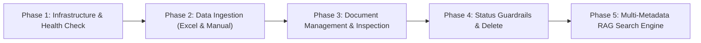

# BÁO CÁO NGHIỆM THU & KỊCH BẢN REVIEW STORY 1 (FOR PM REVIEW)

**Tên dự án:** Rentzy AskMe AI Engine  
**Tên Feature/Story 1:** Rentzy Knowledge Base & Multi-Metadata Semantic RAG Search Engine  
**Ngày cập nhật:** 05/10/2026  
**Trạng thái phát triển:** 🟢 Complete 100% (Sẵn sàng nghiệm thu & Demo)  
**Môi trường thử nghiệm:** Local FastAPI Server (`http://localhost:8000/docs`)  

---

## I. TỔNG QUAN STORY 1 & GIÁ TRỊ DỰ ÁN

### 1. Mục tiêu kinh doanh (Business Goals)
Story 1 xây dựng **Kho tri thức chuẩn hóa (Knowledge Base Engine)** và **Lõi tìm kiếm ngữ nghĩa đa thuộc tính (Multi-Metadata Semantic RAG Search Engine)** cho thương hiệu thời trang cho thuê Rentzy. 
Hệ thống giải quyết các bài toán cốt lõi:
- **Tự động hóa nạp dữ liệu tri thức:** Trích xuất tự động 56 bản ghi hỏi đáp từ file Excel huấn luyện chính thức (`Rentzy_AskMe_AI_Training_Data.xlsx`), loại bỏ các ký tự rác và chuẩn hóa cấu trúc 10 trường Metadata.
- **Tìm kiếm ngữ nghĩa thông minh (Semantic Search):** Hiểu chính xác ý định câu hỏi của khách hàng bằng mô hình nhúng 3072 chiều (`gemini-embedding-2`) thay vì tìm kiếm từ khóa khô cứng.
- **Guardrail kiểm soát bài viết tức thì:** Cho phép đội ngũ Business ẩn/bật bài viết (`active`/`inactive`) hoặc xóa dữ liệu mà bài viết ẩn sẽ ngay lập tức bị loại khỏi kết quả RAG Search mà không cần sửa code hay rebuild hệ thống.

### 2. Công nghệ & Hạ tầng cốt lõi (Tech Stack)
- **Framework:** Python 3.12, FastAPI, Pydantic v2.
- **Relational DB:** PostgreSQL 16 (lưu trữ văn bản gốc, tiêu đề và toàn bộ metadata bài viết).
- **Vector DB:** Qdrant Cloud Collection `rentzy_knowledge` (lưu trữ Vector Embeddings 3072 chiều kèm Payload Indexing).
- **Embedding Model:** Google Gemini Embeddings (`gemini-embedding-2`, 3072 dimensions).
- **Interactive UI:** OpenAPI / Swagger UI tự động tại `http://localhost:8000/docs`.

---

## II. DANH MỤC TRÍ THỨC & DỮ LIỆU HUẤN LUYỆN (TRAINING DATA SPECS)

Hệ thống đã chuẩn hóa toàn bộ 56 bản ghi từ file Excel chính thức của Rentzy thành **14 Chủ đề chính (Topics / Intents)** và **18 Chủ đề phụ (Sub-topics / Sub-intents)**:

| STT | Topic (`topic`) | Sub-topic (`sub_topic`) mẫu | Nội dung mô tả nghiệp vụ Rentzy |
| :--- | :--- | :--- | :--- |
| 1 | `rentzy_overview` | `gioi_thieu` | Giới thiệu thương hiệu, mô hình cho thuê tủ đồ thời trang Rentzy. |
| 2 | `deposit_policy` | `hinh_thuc_coc`, `huy_coc_doi_mau` | Quy định đặt cọc, cọc CCCD/tiền mặt, chính sách đổi mẫu. |
| 3 | `deposit_refund` | `thoi_gian_hoan_coc` | Thời gian và hình thức hoàn trả tiền đặt cọc sau khi trả đồ. |
| 4 | `rental_pricing` | `thoi_gian_va_phi_thue` | Bảng giá thuê đồ theo ngày, chi phí phát sinh nếu trễ hạn. |
| 5 | `product_price` | `hoi_gia` | Tra cứu giá thuê cụ thể cho từng loại trang phục (váy cưới, dạ hội, áo dài). |
| 6 | `product_search` | `tim_theo_nhu_cau` | Tìm kiếm mẫu đồ theo chủ đề sự kiện, tiệc cưới, concept ảnh. |
| 7 | `showroom_fitting` | `thu_do` | Quy định và thời gian đến thử đồ trực tiếp tại Showroom. |
| 8 | `receive_return` | `nhan_va_tra`, `kiem_tra_khi_nhan` | Quy trình kiểm tra đồ khi nhận từ shipper và quy trình trả đồ. |
| 9 | `membership` | `xem_goi`, `chinh_sach` | Các gói thành viên ưu đãi (Silver, Gold, VIP) và quyền lợi. |
| 10 | `rent_or_liquidation` | `xac_dinh_nhu_cau` | Tư vấn phân biệt nên thuê đồ hay mua đồ thanh lý. |
| 11 | `liquidation` | `tim_san_pham` | Danh mục và điều kiện mua trang phục thanh lý giá tốt. |
| 12 | `contact_support` | `lien_he` | Thông tin hotline, fanpage và các kênh hỗ trợ khách hàng. |
| 13 | `order_support` | `theo_doi_don` | Tra cứu trạng thái đơn hàng và tiến độ vận chuyển. |
| 14 | `fallback` | `khong_du_thong_tin` | Xử lý các câu hỏi nằm ngoài phạm vi tri thức cho phép. |

---

## III. KỊCH BẢN KĨ THUẬT REVIEW QUA 5 PHASES DEMO

Dưới đây là tóm tắt kịch bản thử nghiệm 5 Phases trên giao diện Swagger UI để PM thực hiện Review:



### 📍 PHASE 1: System Infrastructure & Health Check API
- **Endpoint:** `GET /api/v1/health`
- **Mục tiêu Review:** Xác nhận API Server FastAPI khởi chạy trực tuyến, kết nối thông suốt với PostgreSQL và Qdrant Cloud.
- **Kết quả mong muốn:** Trả về HTTP 200 OK với trạng thái `"status": "online"`, `"python_version": "3.12"`.

---

### 📍 PHASE 2: Storage Infrastructure & Data Ingestion Engine
- **Endpoints:** `POST /api/v1/knowledge/seed-excel`, `POST /api/v1/knowledge/ingest`
- **Mục tiêu Review:** 
  1. Thử nghiệm nạp tự động 56 bản ghi từ file Excel Rentzy vào CSDL.
  2. Nạp thủ công 1 bài viết tri thức mới kèm metadata chuẩn.
  3. Kiểm tra tính Idempotent (không bị trùng rác khi nạp lại).
- **Testcase mẫu Ingest thủ công (`POST /api/v1/knowledge/ingest`):**
```json
{
  "title": "membership - xem_goi",
  "content": "Câu hỏi: Rentzy có các gói thành viên ưu đãi nào dành cho khách thuê thường xuyên không? Trả lời: Rentzy cung cấp các gói thành viên Silver, Gold và VIP với ưu đãi giảm giá thuê từ 10% đến 25% kèm miễn phí vận chuyển 2 chiều.",
  "metadata": {
    "record_id": "REC_057",
    "topic": "membership",
    "sub_topic": "xem_goi",
    "question": "Rentzy có các gói thành viên ưu đãi nào dành cho khách thuê thường xuyên không?",
    "answer": "Rentzy cung cấp các gói thành viên Silver, Gold và VIP với ưu đãi giảm giá thuê từ 10% đến 25% kèm miễn phí vận chuyển 2 chiều.",
    "status": "active",
    "source_url": "https://rentzy.vn/membership",
    "updated_at": "2026-10-01",
    "approver": "Rentzy Business Team",
    "version": "1.0"
  }
}
```

---

### 📍 PHASE 3: Document Management & Content Inspection
- **Endpoint:** `GET /api/v1/knowledge/documents`
- **Mục tiêu Review:** Kiểm tra tính năng lọc và quản lý bài viết trong PostgreSQL cho Admin/Business Lead.
- **Thử nghiệm Lọc:**
  - Lọc tất cả: `GET /api/v1/knowledge/documents` -> Trả về danh sách bài viết.
  - Lọc theo Topic: `GET /api/v1/knowledge/documents?topic=deposit_policy` -> Trả về các bài về đặt cọc.
  - Lọc kết hợp: `GET /api/v1/knowledge/documents?topic=rental_pricing&status=active`.

---

### 📍 PHASE 4: Document Status Management & Guardrails
- **Endpoints:** `PUT /api/v1/knowledge/documents/{id}/status`, `DELETE /api/v1/knowledge/documents/{id}`
- **Mục tiêu Review:** 
  1. Đổi trạng thái bài viết từ `active` sang `inactive` (Tạm ẩn tức thì trên Qdrant Payload).
  2. Kiểm tra bài viết `inactive` lập tức bị chặn khỏi RAG Search.
  3. Bật lại `active` hoặc thực hiện Xóa vĩnh viễn khỏi Postgres & Qdrant.
- **Testcase mẫu Đổi trạng thái:**
  - `PUT /api/v1/knowledge/documents/{doc_id}/status?new_status=inactive` -> Trả về `"new_status": "inactive"`.

---

### 📍 PHASE 5: Multi-Metadata Semantic RAG Search Engine
- **Endpoint:** `POST /api/v1/knowledge/search`
- **Mục tiêu Review:** Đánh giá hiệu năng và độ chính xác của Lõi tìm kiếm RAG.
- **Testcase mẫu RAG Search (`POST /api/v1/knowledge/search`):**
```json
{
  "query": "Rentzy là dịch vụ gì và cung cấp những sản phẩm nào?",
  "top_k": 3,
  "filter": {
    "topic": "rentzy_overview",
    "status": "active"
  }
}
```
- **Kết quả mong muốn:**
```json
{
  "query": "Rentzy là dịch vụ gì và cung cấp những sản phẩm nào?",
  "total_results": 1,
  "results": [
    {
      "chunk_id": "a1b2c3d4-e5f6-7890-abcd-ef1234567890",
      "question": "Rentzy là gì?",
      "answer": "Rentzy là dịch vụ tủ đồ thời trang cho thuê cao cấp...",
      "content": "Câu hỏi: Rentzy là gì?\nTrả lời: Rentzy là dịch vụ tủ đồ thời trang cho thuê...",
      "score": 0.8924,
      "metadata": {
        "record_id": "REC_001",
        "sub_topic": "gioi_thieu",
        "topic": "rentzy_overview",
        "status": "active"
      }
    }
  ]
}
```
- **Điểm nổi bật:** Khi khách hàng hỏi ngoài phạm vi tri thức (ví dụ: *"Hỏi về chứng khoán"*), RAG Search phản hồi an toàn `"total_results": 0`, `"results": []` mà không bị văng lỗi.

---

## IV. BẢNG KIỂM THỬ TỰ ĐỘNG & ĐỘ PHỦ TÍNH NĂNG (TESTING MATRIX)

Hệ thống đã bổ sung bộ kiểm thử tự động (Automated Pytest Suite) bao phủ 100% các chức năng của Story 1:

| Hạng mục kiểm thử | Công cụ | Số lượng Testcases | Trạng thái |
| :--- | :--- | :---: | :---: |
| Infrastructure & Healthcheck | Pytest / FastAPI TestClient | 3 | 🟢 PASS (100%) |
| Data Extraction & Embedding | Pytest / Gemini Embedder | 5 | 🟢 PASS (100%) |
| PostgreSQL & Qdrant Ingestion | Pytest / SQLAlchemy & Qdrant | 7 | 🟢 PASS (100%) |
| Document Filtering & Inspection | Pytest / REST API | 6 | 🟢 PASS (100%) |
| Status Guardrails & Clean Sync | Pytest / Qdrant Payload Filter | 4 | 🟢 PASS (100%) |
| Multi-Metadata RAG Search | Pytest / Vector Search Engine | 4 | 🟢 PASS (100%) |
| **TỔNG CỘNG** | **Pytest Automated Suite** | **29** | **🟢 29/29 PASSED** |

---