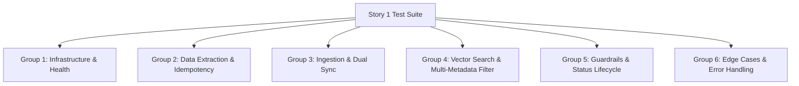
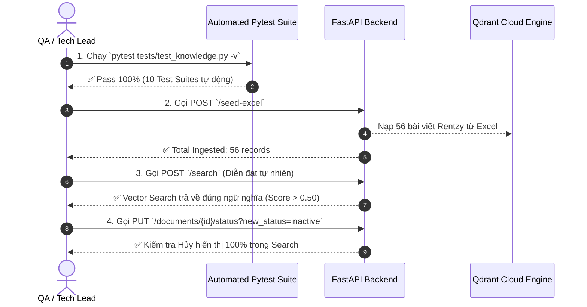

# 🧪 MA TRẬN KIỂM THỬ VÀ QUY TRÌNH VỆ RIFY TOÀN DIỆN (STORY 1)

> **Dự án:** Rentzy Knowledge Storage & Search Engine  
> **Phiên bản:** Story 1 - RAG Foundation & Vector Search  
> **Cập nhật:** 02/10/2026  

---

## 1. PHÂN LOẠI VÀ DANH SÁCH TESTCASE TOÀN DIỆN (MASTER TEST SUITE)

Để đảm bảo hệ thống **Knowledge Base & Vector Search Engine** đạt tiêu chuẩn Production, các Testcase được chia thành **6 nhóm chức năng chuyên sâu**:



---

### 📋 NHÓM 1: INFRASTRUCTURE & HEALTH CHECK
| STT | Mã TC | Tên Testcase | Mô tả kịch bản | Kết quả kỳ vọng | Loại Test |
| :--- | :--- | :--- | :--- | :--- | :--- |
| 1 | `TC_INF_01` | API Health Check | Gửi `GET /api/v1/health` | Trả về `200 OK`, `status: "online"`, Python version 3.12 | Integration |
| 2 | `TC_INF_02` | Database Connection Fallback | Khởi động hệ thống khi Postgres chưa sẵn sàng | Hệ thống tự động chuyển sang SQLite local (`db/rentzy_kb.db`) không crash | Resilience |
| 3 | `TC_INF_03` | Qdrant Collection Health | Kết nối Qdrant Cloud Cluster | Collection `rentzy_knowledge_base` tồn tại với `vector_size=3072` (Cosine) | Smoke |

---

### 📋 NHÓM 2: DATA EXTRACTION & IDEMPOTENCY (EXCEL BATCH)
| STT | Mã TC | Tên Testcase | Mô tả kịch bản | Kết quả kỳ vọng | Loại Test |
| :--- | :--- | :--- | :--- | :--- | :--- |
| 4 | `TC_EXT_01` | Excel Parsing | Đọc dữ liệu từ `Rentzy_AskMe_AI_Training_Data.xlsx` | Bóc tách chính xác đủ 56 bản ghi, làm sạch khoảng trắng/HTML | Data Unit |
| 5 | `TC_EXT_02` | Idempotent Seed Ingest | Gọi `POST /api/v1/knowledge/seed-excel` 2 lần liên tiếp | Không sinh dữ liệu trùng lặp; bản ghi cũ được cập nhật phiên bản/nội dung | Ingestion |
| 6 | `TC_EXT_03` | Schema Mapping Validation | Kiểm tra ánh xạ cột Excel sang Metadata DB | Đầy đủ các trường: `topic`, `approver`, `status`, `version`, `source_url` | Data Unit |

---

### 📋 NHÓM 3: INGESTION & DUAL STORAGE SYNC
| STT | Mã TC | Tên Testcase | Mô tả kịch bản | Kết quả kỳ vọng | Loại Test |
| :--- | :--- | :--- | :--- | :--- | :--- |
| 7 | `TC_ING_01` | Manual Ingest Single Document | Gọi `POST /api/v1/knowledge/ingest` kèm JSON payload đầy đủ | Trả về Document ID UUID; lưu đồng thời vào DB & Qdrant Cloud | Integration |
| 8 | `TC_ING_02` | Embedding Vector Dimension | Nạp tài liệu mới qua Embedding Service | Vector trả về từ Google Gemini (`gemini-embedding-2`) có đúng **3072 chiều** | Vector Unit |
| 9 | `TC_ING_03` | Payload Indexing in Qdrant | Kiểm tra Payload Indexing của Qdrant | Tạo payload index thành công cho `status`, `topic`, `approver`, `version` | Vector Unit |

---

### 📋 NHÓM 4: VECTOR SEARCH & MULTI-METADATA FILTERING
| STT | Mã TC | Tên Testcase | Mô tả kịch bản | Kết quả kỳ vọng | Loại Test |
| :--- | :--- | :--- | :--- | :--- | :--- |
| 10 | `TC_SCH_01` | Semantic Search Accuracy | Tìm kiếm câu hỏi tự nhiên: *"Tôi được thử bao nhiêu bộ đồ?"* | Trả về bài viết thử đồ với Score Cosine $\ge 0.50$ | Semantic |
| 11 | `TC_SCH_02` | Single Topic Filtering | Tìm kiếm câu hỏi bất kỳ kèm `filter: {"topic": "showroom_policy"}` | 100% kết quả trả về thuộc topic `showroom_policy` | Filter |
| 12 | `TC_SCH_03` | Multi-Field Metadata Filter | Lọc kết hợp đồng thời: `status="active"`, `approver="Business Team"`, `version="1.0"` | Chỉ trả về bài viết đáp ứng TẤT CẢ các điều kiện trên | Filter |
| 13 | `TC_SCH_04` | Top_K Parameter Limit | Gửi truy vấn với `top_k = 1`, `top_k = 3`, `top_k = 5` | Số lượng kết quả `len(results)` chính xác $\le top\_k$ | API |

---

### 📋 NHÓM 5: GUARDRAILS & STATUS LIFECYCLE (ACTIVE / INACTIVE)
| STT | Mã TC | Tên Testcase | Mô tả kịch bản | Kết quả kỳ vọng | Loại Test |
| :--- | :--- | :--- | :--- | :--- | :--- |
| 14 | `TC_GRD_01` | Active Search Enforcement | Tìm kiếm không truyền filter status | Mặc định hệ thống tự động gắn `filter: {"status": "active"}` | Guardrail |
| 15 | `TC_GRD_02` | Inactive Article Hiding | Chuyển bài viết từ `active` $\rightarrow$ `inactive` qua `PUT /documents/{id}/status` | Bài viết **LẬP TỨC BIẾN MẤT** hoàn toàn khỏi kết quả tìm kiếm | Lifecycle |
| 16 | `TC_GRD_03` | Re-Activation Recovery | Chuyển bài viết từ `inactive` $\rightarrow$ `active` trở lại | Bài viết **LẬP TỨC XUẤT HIỆN** lại trong kết quả tìm kiếm | Lifecycle |
| 17 | `TC_GRD_04` | Approved Content Filter | Chỉ lọc bài viết đã được Rentzy phê duyệt (`status == "active"`) | Đảm bảo tuân thủ tuyệt đối quy định chỉ truy xuất thông tin đã phê duyệt | Compliance |

---

### 📋 NHÓM 6: DOCUMENT DELETION SYNC & EDGE CASES
| STT | Mã TC | Tên Testcase | Mô tả kịch bản | Kết quả kỳ vọng | Loại Test |
| :--- | :--- | :--- | :--- | :--- | :--- |
| 18 | `TC_EDG_01` | Document Deletion Dual Sync | Gọi `DELETE /api/v1/knowledge/documents/{id}` | Xóa bản ghi trong Postgres VÀ xóa triệt để Vector trong Qdrant Cloud | Sync Delete |
| 19 | `TC_EDG_02` | 404 Non-Existent Document | Thao tác Update Status / Delete với UUID hư cấu | Trả về lỗi `404 Not Found` kèm thông điệp rõ ràng | Exception |
| 20 | `TC_EDG_03` | Empty Search Result | Tìm kiếm với từ khóa hoàn toàn không liên quan hoặc filter không khớp | Trả về `total_results: 0`, `results: []`, status `200 OK` không crash | Edge Case |

---

## 2. QUY TRÌNH 4 BƯỚC VERIFY VÀ NGHỆM THỦ (VERIFICATION STEPS)



---

## 3. HƯỚNG DẪN THỰC THI KIỂM THỬ

### Bước 1: Kiểm thử Tự động qua Pytest (Automated Test Suite)
Mở Terminal và chạy câu lệnh:
```bash
.venv\Scripts\pytest tests/test_knowledge.py -v
```

### Bước 2: Kiểm thử Thủ công qua FastAPI Swagger UI
1. Khởi động server:
   ```bash
   .venv\Scripts\python -m uvicorn app.main:app --reload
   ```
2. Truy cập Swagger UI tại: `http://localhost:8000/docs`
3. Thực hiện kiểm thử trực quan các Endpoint:
   - `POST /api/v1/knowledge/seed-excel`: Nạp toàn bộ dữ liệu Excel mẫu.
   - `POST /api/v1/knowledge/search`: Thử nghiệm các câu hỏi tự nhiên và lọc Metadata.
   - `PUT /api/v1/knowledge/documents/{id}/status`: Đổi trạng thái `active` $\leftrightarrow$ `inactive` để kiểm chứng Guardrail.
