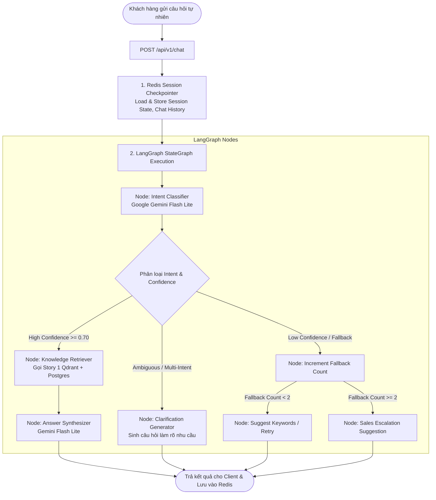

# 📋 KẾ HOẠCH TRIỂN KHAI KỸ THUẬT STORY 2 (APPROVED TECH STACK)

> **Dự án:** Rentzy AskMe AI Engine  
> **Tính năng:** Story 2 — Nhận Diện Ý Định & Điều Hướng Hội Thoại AskMe (Intent Recognition & Dialogue Routing)  
> **Công nghệ lõi:** LangGraph + Redis + Google Gemini Flash Lite  
> **Trạng thái:** Approved Planning  

---

## 📐 THIẾT KẾ KIẾN TRÚC LUỒNG HỘI THOẠI (LANGGRAPH STATEGRAPH)

Story 2 xây dựng **LangGraph StateGraph** điều phối các trạng thái trò chuyện theo mô hình máy trạng thái (State Machine). Tất cả lịch sử trò chuyện và biến trạng thái (`fallback_count`, `current_intent`, `chat_history`) được lưu trữ tập trung tại **Redis Session Store**.

---

## 🛠️ CÔNG NGHỆ SỬ DỤNG (APPROVED TECH STACK)

1. **Dialogue Orchestration Engine:** **`LangGraph`** (`langgraph`, `langchain-core`) xây dựng StateGraph điều hướng đa trạng thái, xử lý rẽ nhánh điều kiện và luồng lặp làm rõ nhu cầu.
2. **Session Store & Memory Persistence:** **`Redis`** (`redis-py`) lưu trữ lịch sử tin nhắn, biến trạng thái phiên chat (`session_id`) và đếm số lần thất bại (`fallback_count`).
3. **LLM Engine:** **`Google Gemini Flash Lite`** (`gemini-2.0-flash-lite`) thông qua `google-genai` SDK cho tốc độ xử lý dưới 500ms.
4. **Vector Search & Storage:** Kế thừa 100% từ Story 1 (Qdrant Cloud 3072 dims & PostgreSQL / SQLite).
5. **API & Validation:** FastAPI, Pydantic v2, Pytest 9.1.

---

## 🎯 DANH SÁCH 14 INTENT TRONG PHẠM VI DỮ LIỆU RENTZY

| STT | Mã Intent (`intent`) | Tên Intent | Mô tả & Ví dụ câu hỏi |
| :--- | :--- | :--- | :--- |
| 1 | `rentzy_overview` | Giới thiệu Rentzy & Dịch vụ | *"Rentzy là gì?", "Giới thiệu thương hiệu Rentzy"* |
| 2 | `rent_or_liquidation` | Phân biệt Thuê hay Mua thanh lý | *"Tôi nên thuê hay mua thanh lý?", "Dùng 1 lần thì nên thuê hay mua?"* |
| 3 | `deposit_policy` | Quy định & Hình thức cọc | *"Cọc bao nhiêu tiền?", "Chính sách cọc cccd và hủy cọc đổi mẫu"* |
| 4 | `rental_pricing` | Bảng giá thuê & Thời gian | *"Tính giá thuê đồ theo ngày như thế nào?", "Trả trễ hạn phạt sao?"* |
| 5 | `product_price` | Tra cứu giá sản phẩm cụ thể | *"Đầm dạ hội này giá thuê bao nhiêu tiền?"* |
| 6 | `product_search` | Tìm kiếm sản phẩm theo nhu cầu | *"Tìm cho mình đầm màu đỏ size M đi tiệc cưới"* |
| 7 | `receive_return` | Giao nhận & Đổi trả trang phục | *"Tôi có được thử đồ khi shipper giao đến không?", "Quy trình trả đồ"* |
| 8 | `deposit_refund` | Thời gian & Chính sách hoàn cọc | *"Bao lâu thì tôi nhận lại tiền đặt cọc sau khi trả đồ?"* |
| 9 | `showroom_fitting` | Thử đồ trực tiếp tại Showroom | *"Tôi có thể đến thử đồ trực tiếp tại showroom không?"* |
| 10 | `membership` | Gói thành viên & Membership | *"Rentzy có các gói thành viên ưu đãi nào?", "Quyền lợi gói VIP"* |
| 11 | `liquidation` | Sản phẩm & Mua bán thanh lý | *"Rentzy có bán thanh lý đồ cũ không?", "Cho xin giá tly váy"* |
| 12 | `contact_support` | Liên hệ hỗ trợ CSKH & Sales | *"Cho tôi gặp nhân viên tư vấn hoặc xin số hotline CSKH"* |
| 13 | `order_support` | Theo dõi & Hỗ trợ đơn hàng | *"Tôi muốn kiểm tra trạng thái đơn hàng của tôi"* |
| 14 | `fallback` | Ngoài phạm vi tri thức Rentzy | *"Hôm nay thời tiết Hà Nội thế nào?", "Dịch thuật bài báo này"* |

---

## 🗂️ PHÂN CHIA CÁC PHASE THỰC THI (PHASE BREAKDOWN)

### 📍 Phase 1 — Intent Catalog & Redis Session Setup
- **Mục tiêu:** Định nghĩa danh mục 14 Intent, danh sách từ viết tắt (*cọc, tly, sm, pky...*) và kết nối Redis Session Manager.
- **Input:** Config Redis (`REDIS_URL=redis://localhost:6379`), Schemas Chat (`app/schemas/chat.py`).
- **Output:** Module `app/core/intents.py` và `app/services/session.py` (Redis Session Store).
- **Điều kiện hoàn thành:** Kết nối Redis container thành công, lưu/đọc Session State đạt tốc độ $< 10ms$.

---

### 📍 Phase 2 — LangGraph StateGraph Core Construction
- **Mục tiêu:** Xây dựng khung StateGraph trong LangGraph quản lý các Node trạng thái và Edge điều kiện.
- **Input:** `AgentState` chứa `session_id`, `messages`, `intent`, `confidence`, `fallback_count`.
- **Output:** Module `app/graph/dialogue_graph.py` thiết lập luồng đi của câu hỏi.
- **Điều kiện hoàn thành:** Graph khởi tạo thành công và chạy thử qua được các nút rẽ nhánh.

---

### 📍 Phase 3 — Gemini Flash Lite Intent Classification Node
- **Mục tiêu:** Xây dựng Node phân loại Intent dùng Google Gemini Flash Lite với Prompt Few-shot xử lý lỗi chính tả và từ viết tắt.
- **Input:** Tin nhắn người dùng & Chat History từ Redis.
- **Output:** `intent` (1 trong 14 mã), `confidence` ($0.0 \rightarrow 1.0$), `suggested_options` (nếu multi-intent / mơ hồ).
- **Điều kiện hoàn thành:** Nhận diện đúng 14 Intent với thời gian xử lý $< 500ms$.

---

### 📍 Phase 4 — Dialogue Routing & Sales Escalation Node
- **Mục tiêu:** Xây dựng các Node rẽ nhánh: Lấy tri thức Story 1, Hỏi làm rõ nhu cầu, và Đề xuất chuyển Sales khi `fallback_count >= 2`.
- **Input:** Output từ Node Classifier.
- **Output:** Nội dung phản hồi cuối cùng và cập nhật lại `fallback_count` trong Redis.
- **Điều kiện hoàn thành:** Sau 2 lần liên tiếp không hiểu, LangGraph tự động kích hoạt Node đề xuất Sales Agent.

---

### 📍 Phase 5 — Main Chat API Endpoint (`POST /api/v1/chat`)
- **Mục tiêu:** Tích hợp LangGraph Compiled Graph vào FastAPI Route.
- **Input:** Request Payload JSON (`session_id`, `message`).
- **Output:** Response JSON (`session_id`, `intent`, `confidence`, `reply_message`, `suggest_sales`, `need_clarification`).
- **Điều kiện hoàn thành:** Endpoint `/api/v1/chat` chạy mượt mà trên Swagger UI.

---

### 📍 Phase 6 — Automated Testing Suite
- **Mục tiêu:** Viết bộ test tự động `tests/test_chat.py` kiểm thử 14 Intent, luồng Redis Session và quy tắc chuyển Sales.
- **Output:** Pytest suite 100% Pass (29/29 Passed).
