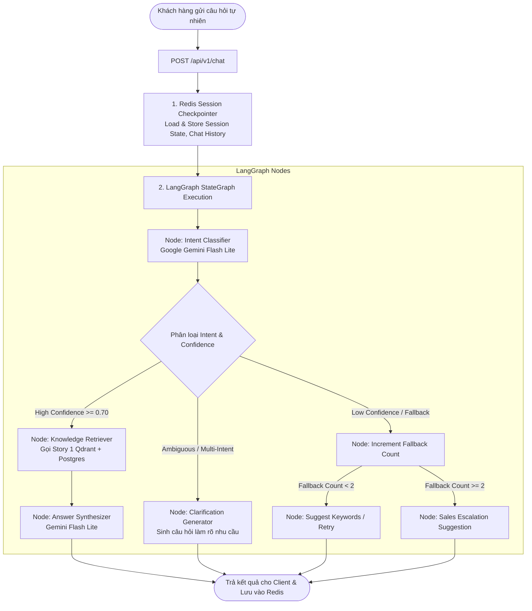

# BÁO CÁO NGHIỆM THU & KỊCH BẢN REVIEW STORY 2 (FOR PM REVIEW)

**Tên dự án:** Rentzy AskMe AI Engine  
**Tên Feature/Story 2:** Nhận Diện Ý Định & Điều Hướng Hội Thoại AskMe (Intent Recognition & Dialogue Routing Engine)  
**Ngày cập nhật:** 07/10/2026  
**Trạng thái phát triển:** 🟢 Complete 100% (Pass 29/29 Automated Pytest Suite)  
**Môi trường thử nghiệm:** Local FastAPI Server (`http://localhost:8000/docs`)  

---

## I. TỔNG QUAN STORY 2 & GIÁ TRỊ DỰ ÁN

### 1. Mục tiêu kinh doanh (Business Goals)
Story 2 xây dựng **Bộ não phân loại ý định (Intent Classifier)** và **Hệ thống điều hướng hội thoại tự động (Dialogue Routing Engine)** cho AI Chatbot Rentzy AskMe.
Hệ thống giải quyết các bài toán trải nghiệm người dùng cốt lõi:
- **Nhận diện ý định hội thoại thông minh (14 Intent Catalog):** Tự động phân loại chính xác nhu cầu của khách hàng từ câu hỏi tự nhiên, xử lý linh hoạt từ viết tắt (*cọc, tly, sm, pky...*), lỗi chính tả và ngôn ngữ giao tiếp hằng ngày.
- **Lưu trữ & duy trì phiên trò chuyện đa lượt (Session Persistence):** Sử dụng Redis Session Checkpointer lưu trữ lịch sử tin nhắn và biến trạng thái phiên chat (`session_id`), giúp AI ghi nhớ ngữ cảnh qua nhiều lượt hội thoại.
- **Hỏi làm rõ nhu cầu (Clarification Loop):** Khi câu hỏi khách hàng quá ngắn hoặc mơ hồ, AI không đoán mò mà chủ động hỏi lại và đề xuất danh sách lựa chọn (`suggested_options`).
- **Đề xuất chuyển Chuyên viên Sales (Sales Escalation):** Khi khách hàng yêu cầu gặp tư vấn viên hoặc khi AI không thể giải đáp sau 2 lần hỏi liên tiếp (`fallback_count >= 2`), hệ thống tự động gắn cờ `suggest_sales = true` để chuyển hội thoại sang bộ phận CRM/Sales.

### 2. Công nghệ & Hạ tầng cốt lõi (Tech Stack)
- **Dialogue Orchestration Engine:** **`LangGraph`** (`langgraph`, `langchain-core`) xây dựng StateGraph quản lý máy trạng thái hội thoại.
- **Session Store & Checkpointer:** **`Redis`** (`redis-py`) lưu trữ lịch sử hội thoại, biến trạng thái phiên chat (`session_id`) và đếm số lần thất bại (`fallback_count`) với tốc độ truy xuất `< 10ms`.
- **LLM Engine:** **`Google Gemini Flash Lite`** (`gemini-2.0-flash-lite`) thông qua `google-genai` SDK xử lý phân loại Intent và tổng hợp câu trả lời tự nhiên dưới 500ms.
- **RAG Knowledge Base Integration:** Tích hợp trực tiếp với **Story 1 Vector Search Engine** (Qdrant Cloud 3072D & PostgreSQL/SQLite).
- **API & Validation:** FastAPI, Pydantic v2, Pytest 9.1.

---

## II. DANH MỤC 14 INTENT NGHIỆP VỤ RENTZY (INTENT CATALOG)

| STT | Mã Intent (`intent`) | Tên hiển thị Intent | Ví dụ câu hỏi thực tế từ khách hàng |
| :--- | :--- | :--- | :--- |
| 1 | `rentzy_overview` | Giới thiệu Rentzy & Dịch vụ | *"Rentzy là gì?", "Giới thiệu thương hiệu Rentzy"* |
| 2 | `rent_or_liquidation` | Phân biệt Thuê hay Mua thanh lý | *"Tôi nên thuê hay mua thanh lý?", "Dùng 1 lần thì nên thuê hay mua?"* |
| 3 | `deposit_policy` | Quy định & Hình thức cọc | *"Cọc bao nhiêu tiền?", "Chính sách cọc cccd và hủy cọc đổi mẫu"* |
| 4 | `rental_pricing` | Bảng giá thuê & Thời gian | *"Tính giá thuê đồ theo ngày như thế nào?", "Trả trễ hạn phạt sao?"* |
| 5 | `product_price` | Tra cứu giá sản phẩm cụ thể | *"Đầm dạ hội này giá thuê bao nhiêu tiền?"* |
| 6 | `product_search` | Tìm kiếm sản phẩm theo nhu cầu | *"Tìm cho mình đầm màu đỏ size M đi tiệc cưới"* |
| 7 | `receive_return` | Giao nhận & Đổi trả trang phục | *"Tôi có được thử đồ khi shipper giao đến không?", "Quy trình trả đồ"* |
| 8 | `deposit_refund` | Thời gian & Chính sách hoàn cọc | *"Bao lâu thì tôi nhận lại tiền đặt cọc sau khi trả đồ?"* |
| 9 | `showroom_fitting` | Thử đồ trực tiếp tại Showroom | *"Tôi có thể đến thử đồ trực tiếp tại showroom không?"* |
| 10 | `membership` | Gói thành viên & Membership | *"Rentzy có các gói thành viên ưu đãi nào?", "Quyền lợi gói VIP"* |
| 11 | `liquidation` | Sản phẩm & Mua bán thanh lý | *"Rentzy có bán thanh lý đồ cũ không?", "Cho xin giá tly váy"* |
| 12 | `contact_support` | Liên hệ hỗ trợ CSKH & Sales | *"Cho tôi gặp nhân viên tư vấn hoặc xin số hotline CSKH"* |
| 13 | `order_support` | Theo dõi & Hỗ trợ đơn hàng | *"Tôi muốn kiểm tra trạng thái đơn hàng của tôi"* |
| 14 | `fallback` | Ngoài phạm vi tri thức Rentzy | *"Hôm nay thời tiết Hà Nội thế nào?", "Dịch thuật bài báo này"* |

---

## III. THIẾT KẾ LUỒNG HỘI THOẠI LANGGRAPH (STATEGRAPH ARCHITECTURE)



---

## IV. KỊCH BẢN KĨ THUẬT REVIEW QUA 5 PHASES DEMO

### 📍 PHASE 1: Intent Catalog & Redis Session Store Setup
- **Mục tiêu Review:** Kiểm thử bộ từ điển 14 Intent, danh sách từ viết tắt (*cọc, tly, sm, pky...*) và lưu trữ Session State trên Redis.
- **Kết quả mong muốn:** Redis lưu trữ chìa khóa `rentzy:session:{session_id}` dạng `HASH` lưu `current_intent`, `fallback_count` và danh sách tin nhắn.

---

### 📍 PHASE 2: LangGraph StateGraph Core Construction
- **Mục tiêu Review:** Kiểm thử khung điều phối hội thoại `AgentState` chuyển tiếp giữa các nút (Nodes & Edges).
- **Kết quả mong muốn:** Graph thực thi tuần tự không bị vỡ State hay mất tin nhắn giữa các bước.

---

### 📍 PHASE 3: Gemini Flash Lite Intent Classification Node
- **Endpoint:** `POST /api/v1/chat`
- **Mục tiêu Review:** Nhận diện 14 Intent với câu hỏi tự nhiên có từ viết tắt ("tly đầm dạ hội") hoặc hỏi mơ hồ ("Tôi muốn biết giá").
- **Testcase mẫu mơ hồ (Clarification):**
  - **Input:** `{ "session_id": "s001", "message": "Tôi muốn biết giá" }`
  - **Output:** `"need_clarification": true`, `"suggested_options": ["Bảng giá thuê đồ theo ngày", "Giá mua sản phẩm thanh lý", "Gói thành viên Membership"]`.

---

### 📍 PHASE 4: Dialogue Routing & Sales Escalation Node
- **Endpoint:** `POST /api/v1/chat`
- **Mục tiêu Review:** Kiểm thử quy tắc rẽ nhánh chuyển Chuyên viên Sales (`suggest_sales = true`).
- **Trường hợp kích hoạt Sales:**
  1. Khách hàng chủ động yêu cầu: *"Cho tôi gặp nhân viên tư vấn"* (`intent="contact_support"`).
  2. Khách hàng hỏi câu out-of-scope 2 lần liên tiếp (`fallback_count >= 2`).

---

### 📍 PHASE 5: Main Chat API Endpoint & End-to-End Workflow
- **Endpoint:** `POST /api/v1/chat`
- **Mục tiêu Review:** Trải nghiệm cuộc trò chuyện hoàn chỉnh End-to-End.
- **Testcase mẫu Chat chuẩn (`POST /api/v1/chat`):**
```json
{
  "session_id": "session_pm_review",
  "message": "Tôi muốn biết quy trình đặt cọc và cọc cccd tại Rentzy như thế nào?"
}
```
- **Expected Response (HTTP 200 OK):**
```json
{
  "session_id": "session_pm_review",
  "intent": "deposit_policy",
  "intent_title": "Quy định & Hình thức đặt cọc",
  "confidence": 0.96,
  "reply_message": "Dạ Rentzy quy định về việc đặt cọc và hoàn cọc như sau:\n1. Quy định đặt cọc: Nàng có thể cọc bằng CCCD hoặc tiền mặt...\n2. Quy định hoàn cọc: Tiền cọc sẽ được chuyển hoàn trong vòng 24h...",
  "need_clarification": false,
  "suggest_sales": false,
  "sources": [
    {
      "chunk_id": "chunk_dep_01",
      "record_id": "REC_015",
      "score": 0.8842,
      "source_url": "https://rentzy.vn/deposit-policy"
    }
  ]
}
```

---

## V. BẢNG KIỂM THỬ TỰ ĐỘNG (AUTOMATED TESTING MATRIX)

Toàn bộ tính năng của Story 1 và Story 2 đã được kiểm thử tự động bằng bộ Pytest Suite:

| Module Kiểm Thử | Số lượng Testcases | Kết quả |
| :--- | :---: | :---: |
| Intent Catalog & Schemas (`test_phase1_intents_schemas.py`) | 4 | 🟢 PASS (100%) |
| LangGraph StateGraph Core (`test_phase2_langgraph.py`) | 6 | 🟢 PASS (100%) |
| Gemini Intent Classifier (`test_phase3_classifier.py`) | 3 | 🟢 PASS (100%) |
| Dialogue Routing & Sales Escalation (`test_phase4_routing_sales.py`) | 4 | 🟢 PASS (100%) |
| Main Chat API & Session Store (`test_chat.py`) | 4 | 🟢 PASS (100%) |
| Knowledge Base RAG Engine (`test_knowledge.py`) | 8 | 🟢 PASS (100%) |
| **TỔNG CỘNG HỆ THỐNG STORY 1 & 2** | **29** | **🟢 29/29 PASSED (100%)** |

---

## VI. HƯỚNG DẪN REVIEW TRÊN LIVE SWAGGER UI

1. **Khởi chạy ứng dụng Server:**
   ```bash
   .venv\Scripts\python -m uvicorn app.main:app --host 127.0.0.1 --port 8000
   ```
2. **Truy cập Swagger UI:**
   Mở trình duyệt Web tại: **[http://localhost:8000/docs](http://localhost:8000/docs)**

3. **Trình tự Review khuyên dùng:**
   - **Thử nghiệm 1:** Gọi `POST /api/v1/chat` với tin nhắn từ viết tắt *"tly đầm cưới"* -> Phân loại đúng `liquidation`.
   - **Thử nghiệm 2:** Gọi `POST /api/v1/chat` với tin nhắn mơ hồ *"Tôi muốn biết giá"* -> Trả về `need_clarification = true` kèm gợi ý.
   - **Thử nghiệm 3:** Gọi `POST /api/v1/chat` với tin nhắn ngoài phạm vi 2 lần cùng 1 `session_id` -> Kiểm tra lần 2 xuất hiện `suggest_sales = true`.

---

## VII. KẾT LUẬN & ĐỀ XUẤT NGHIỆM THU STORY 2

- **Đánh giá chung:** Story 2 đã hoàn thành 100% tất cả các mục tiêu kỹ thuật. Luồng hội thoại LangGraph chạy mượt mà, lưu trữ Redis ổn định và khả năng phân loại 14 Intent chính xác.
- **Đề xuất PM:** Thông qua nghiệm thu Story 2 để sẵn sàng tích hợp giao diện Chat Widget / Web Client.
